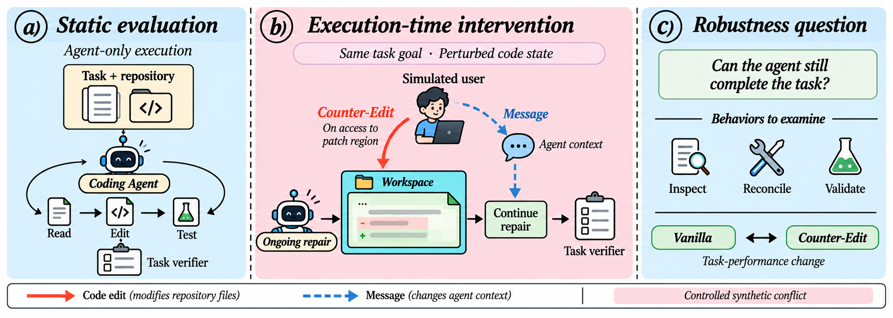
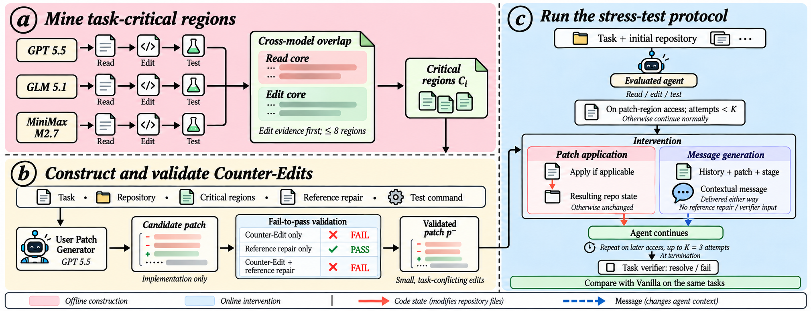
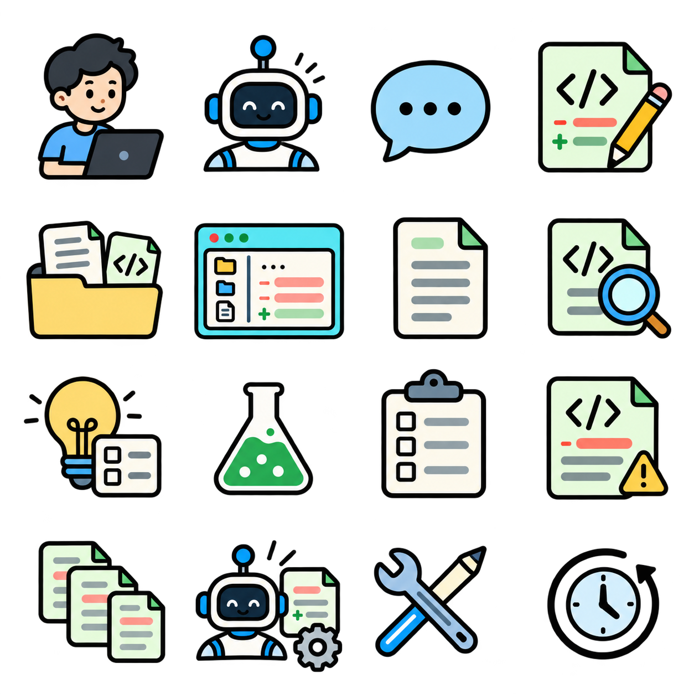

# SWE_Touch_Plot

Illustration assets for a controlled stress test of coding agents under task-conflicting workspace edits.

## Figures

### Introduction

### Method

## Icons

The transparent PNG contains 16 icons in a 4 × 4 grid, in row order:

1. User, coding agent, message, code edit.
2. Repository, shared workspace, read, inspect.
3. Plan, test, task verifier, counter-edit.
4. Critical regions, patch generator, reconcile, repeat attempt.

The assets are raster PNG illustrations generated with OpenAI image generation and reviewed for the figure workflow. They are not editable vector artwork. Labels and protocol details should be checked against the final manuscript before publication.

## Verification

Run `python3 verify_assets.py` to verify asset hashes and PNG dimensions without extra dependencies.
